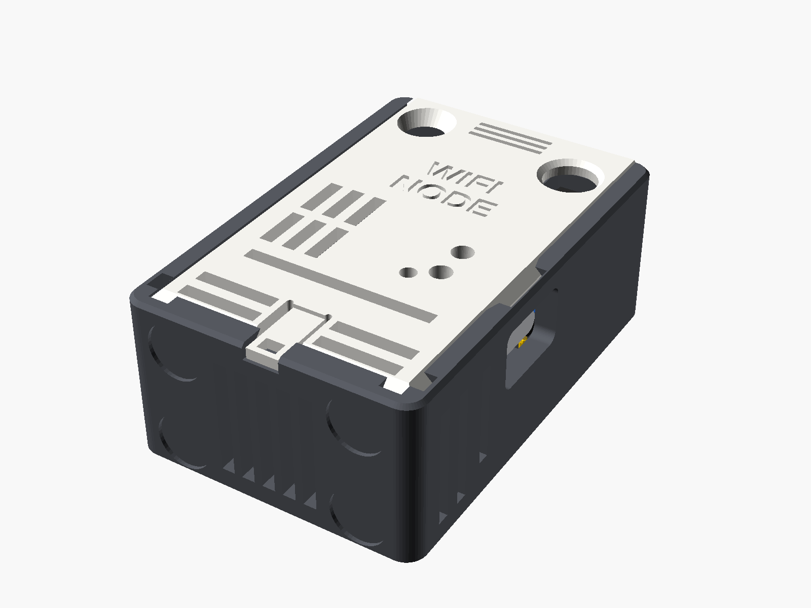
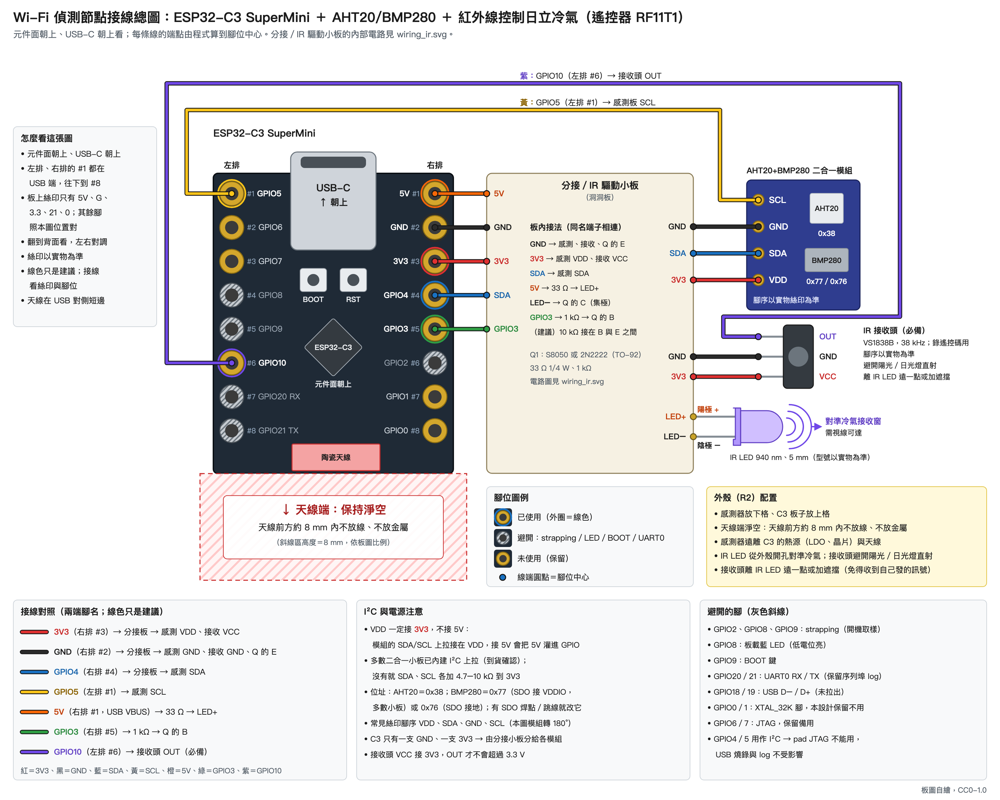

# Wi‑Fi 偵測節點：不裝鏡頭也知道有人｜軟硬整合系列

**MOD-WIFI**：ESP32-C3＋ESPectre（Wi-Fi 動作偵測）＋溫濕度氣壓＋紅外線控制日立冷氣。

> **狀態：韌體編譯通過、靜態檢查通過，尚未實機驗證。**
> 零件還在路上；本 repo 沒有任何實機量測數字。外殼（R2）也還沒印出來。
> 製作過程邊做邊記在 [`docs/JOURNAL.md`](docs/JOURNAL.md)。
>
> **R3 麵包板版（2026-11-21 起）**：溫濕度改用 DHT11 三腳模組、紅外線零件直接插在 170 孔迷你麵包板上。見下方 [R3 麵包板版](#r3-麵包板版)；以下 R2 內容原樣保留。

用家裡的 Wi-Fi 訊號偵測「空間裡有沒有東西在動」（入侵、狗的夜間活動、睡覺時的身體動作），同時量溫度、濕度、氣壓，並且**紅外線控制日立冷氣（遙控器 RF11T1）**。全部接進 Home Assistant，也提供 HTTP JSON 與 Prometheus `/metrics`。

- 開發板：ESP32-C3 SuperMini（排針已焊）
- 感測：AHT20（溫濕度）＋BMP280（氣壓）二合一 I²C 模組
- 動作偵測：[ESPectre](https://github.com/francescopace/espectre)（Wi-Fi CSI），透過 ESPHome 2026.10 起內建的 `espectre` 元件
- 冷氣：940 nm 紅外線 LED 經 NPN 電晶體驅動＋VS1838B 接收頭（**必備**）；ESPHome `climate: hitachi_ac344`（RF11T1 在文獻上對應日立 AC344 格式，**待實機確認**）
- 外殼：兩件式滑蓋殼 R2（OpenSCAD），PLA 黑殼身＋白滑蓋，免支撐；[Onshape 公開文件（R2）](https://cad.onshape.com/documents/20e3a641bf055fec6fb69fdc/w/8c8c83e86c0f45c5d3bed645/e/2099ef07d5082cb81859d333)



<!-- CAD-README-NOTE -->
> 外殼為 **R2**（黑色殼身、白色滑蓋，上端有 IR 發射窗與 VS1838B 接收窗）；尚未印出實物驗證。列印順序見 [`cad/PRINT_ORDER.md`](cad/PRINT_ORDER.md)。

---

## 目錄

| 路徑 | 內容 | 授權 |
|---|---|---|
| `firmware/` | ESPHome 設定檔 `wifi-node.yaml`（R2）與 `wifi-node-dht11.yaml`（R3）、錄碼用 `ir-learn.yaml`、共用的紅外線硬體套件、選配套件、`secrets.example.yaml` | GPL-3.0-only |
| `wiring/` | 腳位表（md＋csv）、彩色接線圖（PNG＋SVG）、紅外線電路圖、檢查清單、產生腳本 | CERN-OHL-P-2.0（自繪元件圖 CC0-1.0） |
| `cad/` | 外殼 R2：OpenSCAD 原始檔、STL（組裝座標與列印姿態）、算繪圖、GLB、列印順序、組裝說明（STEP 與 G-code 在 Release） | CERN-OHL-P-2.0 |
| `bom/` | 零件表（通用規格，不含價格與購買來源）；R3 另有 `BOM_R3.md`／`BOM_R3.csv`（標已有／需補料） | CERN-OHL-P-2.0 |
| `hardware/r3/` | **R3 麵包板版**：外殼 R3（OpenSCAD、STL、算繪圖）、麵包板接線圖（PNG＋SVG） | CERN-OHL-P-2.0（自繪元件圖 CC0-1.0） |
| `docs/` | 架構、韌體、API、日立紅外線協定與逐鍵錄碼、列印、授權、安全、製作紀錄（`JOURNAL.md`）、維護流程（`MAINTAINING.md`） | 見 `docs/licensing.md` |
| `LICENSES/` | 各授權全文 | — |

## 能做什麼／不能做什麼（請先讀）

**做得到**
- 判斷一個空間有沒有在動：`Motion`（有動／沒動）與 `Movement Score`（0–1）
- 看夜間、睡覺時的動作多寡與時段
- 溫度、濕度、氣壓
- 紅外線控制日立冷氣（遙控器 RF11T1）：開關、冷氣／除濕／送風、目標溫度、風速、左右擺風

**做不到（誠實說明）**
- **CSI 只能看到「有動」，分不出人與狗**，也不能數人數、不能證明房間是空的。
- **睡眠只能看到身體動作（翻身、起身），不是睡眠分期**。
- **不是醫療或保全級設備**。
- 需要**穩定的 2.4 GHz 基地台**；Mesh 漫遊換基地台會讓偵測不穩，建議固定連同一台。
- **一台只顧一個空間**；牆體、基地台位置、家具與干擾都會影響。上游建議離基地台約 3–8 m 起試。
- **校準期要保持靜止**：預設偵測器開機時校準，搬動後要重新開機。
- Wi-Fi 省電關閉、無線電一直開，板子會發熱：溫度讀值要和參考溫度計比對求偏移。
- **冷氣協定尚待實機驗證**：RF11T1 在文獻上對應 AC344，要先用接收頭逐鍵錄碼確認（[`docs/IR_HITACHI.md`](docs/IR_HITACHI.md)）。
- **冷氣是單向發射、需要視線可達、沒有冷氣的狀態回饋**：Home Assistant 顯示的是「最後送出的指令」；接收頭＋`receiver_id` 只能追蹤「遙控器按了什麼」，不是冷氣真實狀態。
- 睡眠、快速、節能、定時、防霉等**進階鍵不一定支援**（ESPHome 平台沒有對應控制項；可用學習碼備案）；LED 方向與距離都會影響。

## 零件（BOM 摘要）

| 零件 | 數量 | 備註 |
|---|---|---|
| ESP32-C3 SuperMini（USB-C、排針已焊） | 1 | 22.52 × 18.00 mm |
| AHT20+BMP280 二合一 I²C 模組 | 1 | 約 16 × 16 mm，4 腳 |
| 940 nm 5 mm 紅外線 LED | 1（建議備 2） | 型號以實物為準 |
| NPN 電晶體 S8050 或 2N2222（TO-92） | 1 | 腳序以實物規格書為準 |
| 電阻 33 Ω 1/4 W（LED 限流）、1 kΩ 1/4 W（基極）；建議 10 kΩ（B–E 下拉） | 各 1 | |
| **VS1838B 紅外線接收頭（必備）** | 1 | 首次設定錄 RF11T1 遙控碼、確認協定 |
| 杜邦線或細線、小洞洞板（分接／IR 驅動） | 若干 | |
| USB-C 資料線＋5 V 充電頭、PLA（黑、白）、M3 螺絲＋壁虎 | — | |

完整規格與來源：[`bom/BOM.md`](bom/BOM.md)。

## 接線

| 對象 | C3 SuperMini | 位置（元件面朝上、USB-C 朝上，從 USB 端數） |
|---|---|---|
| 感測板 VDD、接收頭 VCC | 3V3 | 右排 #3 |
| 感測板 GND、接收頭 GND、電晶體射極 | GND | 右排 #2 |
| 感測板 SDA | GPIO4 | 右排 #4 |
| 感測板 SCL | GPIO5 | 左排 #1 |
| 1 kΩ → NPN 基極 | GPIO3 | 右排 #5 |
| IR LED 陽極（經 33 Ω） | 5V（USB VBUS） | 右排 #1 |
| 接收頭 VS1838B OUT | GPIO10 | 左排 #6 |



- C3 只有一支 3V3、一支 GND：經一塊小洞洞板分接給感測板、接收頭與電晶體（見接線圖）。
- **感測板 VDD 接 3V3，不接 5V**（上拉電阻接在 VDD，接 5V 會把 5V 灌進 GPIO）。接收頭也接 3V3。
- 避開 GPIO2／8／9（strapping；8 接板載 LED、9 接 BOOT）、GPIO18／19（USB）、GPIO20／21（UART0）。
- 接收頭避開陽光與日光燈直射、離 IR LED 遠一點或加遮擋。
- **看絲印、不要看線色**；先拔 USB 再接線。腳位表、IR 電流計算與來源：[`wiring/PINMAP.md`](wiring/PINMAP.md)；紅外線電路圖：[`wiring/wiring_ir.png`](wiring/wiring_ir.png)；檢查清單：[`wiring/wiring_checklist.png`](wiring/wiring_checklist.png)。

## 3D 列印

> 狀態：CAD 自動檢查與切片軟體估計；**尚未實際印出驗證**。

本模組和姊妹專案「兒童 AI 問答機」（[mod-ask-kids-ai](https://github.com/h2ocloud/mod-ask-kids-ai)）的外殼**排在同一組兩盤一起印**，只要換一次線材：

| 順序 | 顏色 | 本模組的件 | 切片軟體估計（整盤，含問答機的件） |
|---|---|---|---|
| 1 | 白 PLA | 滑蓋 | 約 10 h、90 g |
| 2 | 黑 PLA | 殼身、兩條頂壓條、3 mm LED 轉接套 ×2 | 約 11.5 h、100 g |

- 通用條件：FDM（作者用 Ender-3 級 220 × 220 熱床）、0.4 mm 噴嘴、PLA、Cura「Low」0.28 mm 層高、2 道牆、**免支撐**、5 mm brim（滑蓋周圍與彈片切縫不留 brim）、**第 1–3 層風扇關閉**。
- 只印本模組：用 `cad/stl/plate/WIFI_WHITE.stl`、`WIFI_BLACK.stl` 自己切片；零件到貨後可先印試配片 `WIFI_COUPON.stl`（約 30 分鐘）。
- 完整順序、為什麼白盤先印、印完先檢查什麼：[`cad/PRINT_ORDER.md`](cad/PRINT_ORDER.md)；組裝步驟：[`cad/ASSEMBLY.md`](cad/ASSEMBLY.md)（IR 腳位以 `wiring/` 為準，見該文件開頭）。
- 兩盤 G-code（作者那台印表機的切片結果，換印表機請用 STL 自己切）與 STEP 附在 [Release v0.1.0](https://github.com/h2ocloud/esp32c3-wifi-sensing-node/releases/tag/v0.1.0)。
- 壁掛方向：感測端朝下、IR 端朝上；滑蓋往上推出。上方要留約 70 mm 才能把滑蓋整個抽出。

## 韌體

需求：ESPHome **2026.10 以上**（本專案用 2026.10.2 編譯）、ESP-IDF 框架（≥ 5.5.3，編譯時自動下載 5.5.6）。

```bash
python3 -m venv .venv && . .venv/bin/activate
pip install "esphome==2026.10.2"
cd firmware
cp secrets.example.yaml secrets.yaml   # 填自己的 Wi-Fi（只支援 2.4 GHz）與密碼；此檔已 gitignore

# 1) 第一次：先確認冷氣協定（接收頭必備）
esphome run ir-learn.yaml              # 拿 RF11T1 遙控器對著接收頭逐鍵按，看 log（流程見 docs/IR_HITACHI.md）

# 2) 確認後燒主設定
esphome run wifi-node.yaml             # 第一次用 USB 燒錄；之後可 OTA
```

- 燒不進去：按住 BOOT → 點一下 RST → 放開 BOOT，再試一次。
- 開機後 log 會列出 I²C 掃描結果：應看到 `0x38`（AHT20）與 `0x77` 或 `0x76`（BMP280）；看到 0x76 就把 `bmp280_address` 改成 `"0x76"`。
- Home Assistant 會自動探索 `wifi-node`；開機後 15 分鐘內完成配對（API 金鑰在第一次配對時才配發，不寫在設定檔）。
- CSI 流量預設 ping 預設閘道；要改 ping 其他主機，打開 `packages/csi-ping-target.yaml`，目標寫在 `secrets.yaml`（不寫死 IP）。
- 冷氣：`ir-learn.yaml` 解出 AC424 時，主設定改 `platform: hitachi_ac424`；兩種都解不出時，用 `packages/ir-raw-scenes.yaml` 把錄到的 raw／pronto 做成固定情境按鈕。
- 選配（預設關）：MQTT（`packages/mqtt.yaml`）、指定 ping 目標、學習碼按鈕。
- HTTP：`GET /sensor/Temperature`、`GET /binary_sensor/Motion`、`POST /climate/Hitachi%20AC/set?mode=COOL&target_temperature=26`、`GET /metrics`。詳見 [`docs/API.md`](docs/API.md)。

編譯結果（ESPHome 2026.10.2，ESP32-C3，靜態 RAM／應用程式分區 flash）：預設設定 RAM 34.2%、Flash 61.0%；全部選配 RAM 35.5%、Flash 67.9%；錄碼韌體 RAM 33.4%、Flash 52.8%。版本需求、CSI 流量、已知限制：[`docs/FIRMWARE.md`](docs/FIRMWARE.md)。

## R3 麵包板版

> **狀態：韌體編譯通過、外殼靜態檢查通過，尚未實機驗證。** 上面各節（R2）原樣保留；R3 只是換料與換外殼，功能相同。

需求方改用手上的料：溫濕度改用 **DHT11 三腳模組**（用附的杜邦線接），**5 mm 紅外線 LED、VS1838B 接收頭**與電阻**直接插在 170 孔迷你麵包板上**，麵包板用背膠黏在殼內。

| 項目 | R2 | R3 |
|---|---|---|
| 溫濕度 | AHT20+BMP280（I²C，有氣壓） | DHT11 三腳模組（單線，沒有氣壓；精度 ±2 °C／±5 %RH） |
| 紅外線電路 | 洞洞板（要焊）；NPN 驅動 | 170 孔迷你麵包板（免焊）；預設直驅，可升級電晶體版 |
| 韌體 | `firmware/wifi-node.yaml` | `firmware/wifi-node-dht11.yaml`（`dht` 平台、`model: DHT11`） |
| 外殼 | `cad/`（R2） | `hardware/r3/`（R3） |
| 零件表 | `bom/BOM.md` | `bom/BOM_R3.md` |

- **腳位**：DHT11 DATA＝**GPIO4**（VCC 接 3V3、GND）；IR 發射＝**GPIO3**（直驅與電晶體版同腳）、IR 接收（VS1838B OUT）＝**GPIO10**；5V 只有電晶體版的 LED 用。麵包板孔位見 [`docs/BREADBOARD_R3.md`](docs/BREADBOARD_R3.md)。
- **需補料（不代購）**：NPN 電晶體（S8050 或 2N2222）**只有升級成電晶體版才需要**；麵包板跳線 6 條（直驅版；電晶體版之後另加 1 條 5V 線），手上沒有就補；高版的 DHT11 要用公母杜邦線，模組附的若是母對母，另補 3 條公母線。
- **紅外線發射兩版**：預設**直驅版**（GPIO3 → 220 Ω → LED，約 9 mA、距離約 1 m，用手上現有的電阻）；補到 NPN 後原位升級成**電晶體版**（基極 1 kΩ、5V 經 3 顆 220 Ω 並聯，約 45–50 mA）。韌體不用改。計算與限制見 [`docs/BREADBOARD_R3.md`](docs/BREADBOARD_R3.md) 第 5 節。
- **完整說明**（零件、腳位、麵包板插法、DHT11 與 AHT20 的差異、外殼、到貨要量）：[`docs/BREADBOARD_R3.md`](docs/BREADBOARD_R3.md)；紅外線學碼照 [`docs/IR_HITACHI.md`](docs/IR_HITACHI.md)（腳位同 R2）。
- 編譯結果（ESPHome 2026.10.2）：RAM 34.2%、Flash 59.9%（比 R2 少約 19 KB flash）。
- **G-code 與 STEP**：等 R3 的 G-code 到齊後，發布 **Release v0.2.0**；R2 的檔案仍在 [Release v0.1.0](https://github.com/h2ocloud/esp32c3-wifi-sensing-node/releases/tag/v0.1.0)。

## 授權

- **韌體（`firmware/`）：GPL-3.0-only。** 韌體使用 ESPectre（GPL-3.0-only）與 ESPHome 的 C++ 執行程式碼（GPLv3），編出來的韌體是一個結合後的程式，散布時整體須以 GPLv3 授權並提供完整對應原始碼。所以本專案韌體設定檔與上游一致採 GPL-3.0-only。
- **硬體（`cad/`、`wiring/`、`bom/`、`hardware/r3/`）：CERN-OHL-P-2.0。** 自繪的元件圖（板子、模組、電晶體、LED、接收頭）另以 CC0-1.0 釋出。
- 文件依所屬部分適用上述授權，細節與理由見 [`docs/licensing.md`](docs/licensing.md)；上游授權與致謝見 [`NOTICE.md`](NOTICE.md)。

## 致謝與上游

- [ESPectre](https://github.com/francescopace/espectre)（Francesco Pace，GPL-3.0-only）— Wi-Fi CSI 動作偵測
- [ESPHome](https://esphome.io/)（MIT／GPLv3）— 韌體框架、`espectre`、`aht10`、`bmp280_i2c`、`hitachi_ac344`、`remote_transmitter`、`remote_receiver` 等元件
- [IRremoteESP8266](https://github.com/crankyoldgit/IRremoteESP8266) — 日立 RF11T1↔AC344 的協定對應資料（本專案未使用其程式碼）
- [ESP-IDF](https://github.com/espressif/esp-idf)（Apache-2.0）

## English (short)

**MOD-WIFI** is an open-source Wi-Fi sensing node: an ESP32-C3 SuperMini running ESPHome with the built-in `espectre` component (Wi-Fi CSI motion detection, upstream: ESPectre), an AHT20+BMP280 module for temperature/humidity/pressure, and IR control of a Hitachi air conditioner (RF11T1 remote) using an NPN-driven 940 nm IR LED plus a required VS1838B receiver (`climate: hitachi_ac344`; RF11T1 is listed as HITACHI_AC344 by IRremoteESP8266 — to be confirmed on the real unit with `ir-learn.yaml`). It integrates with Home Assistant via the native API and also exposes HTTP JSON (ESPHome `web_server`) and Prometheus `/metrics`.

**Status: firmware compiles (ESPHome 2026.10.2, ESP-IDF 5.5.6); not yet tested on real hardware.**

Limitations: CSI only detects *that something moves* — it cannot tell a person from a dog, it is not sleep staging, and it is not a medical or security-grade device. It needs a stable 2.4 GHz AP, covers one room per node, and must stay still during calibration. IR control is one-way (no AC state feedback; the receiver only tracks what the remote sent), needs line of sight, and the protocol must be confirmed on the actual unit.

Case: two-part sliding-lid enclosure, revision R2 (black body, white lid, IR LED and VS1838B windows), printed together with the sister project [mod-ask-kids-ai](https://github.com/h2ocloud/mod-ask-kids-ai) on two shared plates (PLA, 0.28 mm, no supports); not printed yet. STEP and G-code are attached to [Release v0.1.0](https://github.com/h2ocloud/esp32c3-wifi-sensing-node/releases/tag/v0.1.0). A build journal is kept in `docs/JOURNAL.md`.

**R3 breadboard build (since 2026-11-21):** the same functions with a DHT11 3-pin module instead of the AHT20+BMP280 (no pressure; ±2 °C / ±5 %RH), and the IR LED, VS1838B and resistors plugged into a 170-point mini breadboard glued inside the R3 case. The IR LED is driven directly from GPIO3 through 220 Ω by default (~9 mA, ~1 m, estimated); an NPN (S8050/2N2222) upgrade with 3×220 Ω in parallel from 5 V gives ~45–50 mA with the same firmware. Firmware `firmware/wifi-node-dht11.yaml` (compiles; not yet tested on hardware), notes in `docs/BREADBOARD_R3.md`, case and wiring in `hardware/r3/`. The R2 files are kept unchanged.

License: firmware GPL-3.0-only (because of ESPectre/ESPHome); hardware (CAD, wiring, BOM) CERN-OHL-P-2.0; self-drawn part graphics CC0-1.0.
