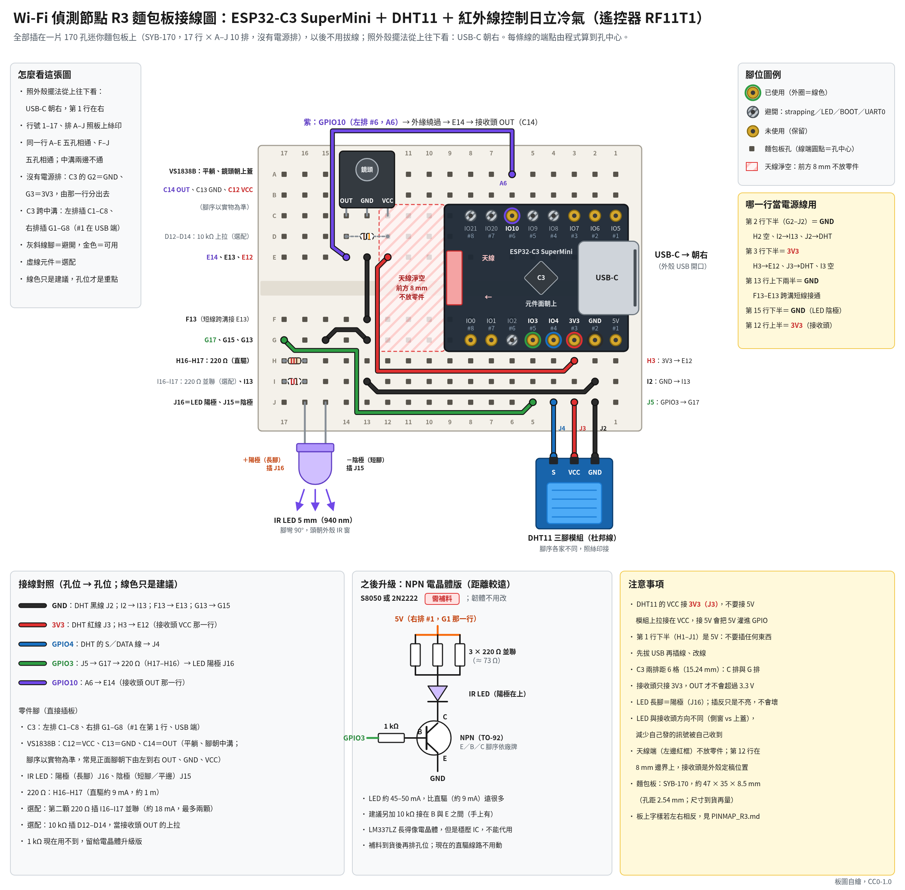

# R3 麵包板版：材料與接線

> **狀態：韌體編譯通過、外殼靜態檢查通過，尚未實機驗證。**
> R3 是 2026-11-21 起的版本：溫濕度改用 **DHT11 三腳模組**（杜邦線），紅外線 LED、VS1838B 接收頭與電阻**直接插在 170 孔迷你麵包板上**，麵包板用背膠黏在殼內。
> 紅外線發射**預設直驅版**（GPIO3 → 220 Ω → LED，手上的料就能接）；補到 NPN 電晶體後可原位升級成**電晶體版**，韌體不用改。
> R2（AHT20+BMP280、洞洞板）的檔案全部保留：`wiring/`、`cad/`、`bom/BOM.md`、`firmware/wifi-node.yaml`。

## 1. 跟 R2 差在哪

| 項目 | R2 | R3 |
|---|---|---|
| 溫濕度 | AHT20+BMP280 二合一 I²C 小板（另有氣壓） | DHT11 三腳模組（單線，沒有氣壓） |
| 紅外線電路 | 洞洞板（要焊）；NPN 驅動，約 103 mA | 170 孔迷你麵包板（免焊）；預設直驅約 9 mA，升級電晶體版約 45–50 mA |
| 外殼 | R2（`cad/`） | R3（`hardware/r3/`） |
| 韌體 | `firmware/wifi-node.yaml` | `firmware/wifi-node-dht11.yaml` |
| 紅外線腳位 | 發射 GPIO3、接收 GPIO10 | 相同（`packages/ir-hardware.yaml` 共用） |
| 零件表 | `bom/BOM.md` | `bom/BOM_R3.md` |

## 2. 零件（摘要）

完整表與狀態（已有／需補料／沿用 R2）見 [`../bom/BOM_R3.md`](../bom/BOM_R3.md)。**需補料的項目不代購，由需求方自行決定。**

- 需求方已有 9 項；**需補料 2 項**；2 項沿用 R2。
- 預設的直驅版用已有的電阻就能接；NPN 電晶體（S8050 或 2N2222）**只有升級成電晶體版才需要**。
- 麵包板跳線 6 條（直驅版；電晶體版之後另加 1 條 5V 線）；短的可以用剪下的零件腳代替。
- 高版的 DHT11 要用**公母杜邦線**（母頭接模組、公頭插麵包板）；模組附的若是母對母，另補 3 條公母線。
- 170 孔麵包板：17 排 × 10 孔、孔距 2.54 mm、背面有背膠；約 47.2 × 35.2 mm、含背膠高約 8.8 mm（設計值，待實物量測）。

## 3. 腳位表（GPIO）

| 功能 | C3 腳 | 麵包板孔（殼內擺位） | 說明 |
|---|---|---|---|
| ESP32-C3 本體 | — | C 欄 1–8 排／G 欄 1–8 排 | 跨中溝插，USB 朝右牆；也可改插 B／F。C 欄 1–8 排＝GPIO5、6、7、8、9、10、20、21，G 欄 1–8 排＝5V、GND、3V3、GPIO4、GPIO3、GPIO2、GPIO1、GPIO0 |
| DHT11 S（DATA） | GPIO4 | J4 | 杜邦線公頭插 J4；J4 與 C3 的 GPIO4（G4）同一排，不用另拉線 |
| DHT11 VCC | 3V3 | J3 | 接 3V3，不接 5V（模組的 DATA 上拉接在 VCC） |
| DHT11 GND | GND | J2 | 看模組絲印接，不看線色 |
| VS1838B VCC | 3V3 | C12 | 平躺、透鏡朝蓋；3V3 由跳線 H3 → E12 送來 |
| VS1838B GND | GND | C13 | GND 由跳線 I2 → I13 送到第 13 排下半，再由短跳線 F13 → E13 跨中溝送上來 |
| VS1838B OUT | GPIO10 | C14 | 跳線 A6 → E14；韌體已開內部上拉（選配 10 kΩ 上拉插 D12–D14） |
| IR LED 陽極（長腳） | GPIO3 | J16 | 直驅：GPIO3 由跳線 J5 → G17 送到第 17 排，經 220 Ω（H16–H17）到 J16；LED 直立朝蓋上的窗 |
| IR LED 陰極（短腳） | GND | J15 | GND 由跳線 G13 → G15 送到第 15 排下半 |
| 5V | 5V | — | **只有電晶體版用**（5V 取自第 1 排下半，經 3 顆 220 Ω 並聯接 LED）；孔位等 NPN 到貨再排，直驅版不接，H1–J1 先不要插 |

孔位編號是自訂的：蓋拿掉、從正面看，第 1 排在右側的 USB 端、第 17 排在左；A 欄在上（接收頭側）、J 欄在下（DHT 艙側）；A–E、F–J 各是一條 5 孔。麵包板若印有字，以孔的位置為準。

避開的腳與理由同 R2（[`../wiring/PINMAP.md`](../wiring/PINMAP.md) 第 4 節）：GPIO2／8／9 是 strapping（8 接板載 LED、9 接 BOOT 鍵），GPIO18／19 是 USB，GPIO20／21 保留給序列埠 log。

## 4. 麵包板接線

先決定印哪一版殼：**高版（主）**或薄版（備選），見[第 9 節](#9-外殼-r3)。兩版的孔位完全相同，差別只在 DHT11 怎麼接回麵包板，以及 LED、VS1838B 的腳留多長。

**接線圖**（直驅版，預設）：照外殼擺法從上往下看，USB-C 朝右；線色只是建議，孔位才是重點。逐孔表與待確認項目見 [PINMAP_R3.md](../hardware/r3/wiring/PINMAP_R3.md)，向量檔見 [wiring_r3_breadboard.svg](../hardware/r3/wiring/wiring_r3_breadboard.svg)。



### 組裝順序

1. **麵包板先推到角落再撕背膠。**把麵包板（背膠還沒撕）放進殼身，推到 USB 側與 DHT 艙側的角落，貼齊四角的 L 形角擋；確認四周留有縫，再撕背膠黏牢。沒推到角的話，USB 插頭可能被擋。
2. **C3 由上往下插進麵包板**，跨中溝插在 C 欄 1–8 排／G 欄 1–8 排，元件面朝蓋，USB-C 朝右牆的孔。實際插成 B／F（往上一格）也行：USB 開口、BOOT／RST 孔、天線槽兩種插法都涵蓋。
3. **DHT11 模組平放進 DHT 艙**（肋上貼小片雙面泡棉膠，見 BOM），本體朝蓋。杜邦線的公頭插 J2（GND）、J3（3V3）、J4（GPIO4）：
   - 高版：公母線的公頭直立插，線從隔牆上緣的缺口翻過去。
   - 薄版：J2–J4 插 1×3 90° 排針（或把直排針彎 90°、或用 3 條扁跳線），線的母頭平躺穿過隔牆孔。
4. **IR LED** 直立插 J16（長腳）、J15（短腳），朝蓋上的窗；**VS1838B** 插 C12–C14，透鏡朝蓋。高版的兩件腳都留長，本體墊高約 10 mm；薄版把 LED 腳剪短到凸緣離板 0–1 mm，VS1838B 先直立插、再往 A 欄方向折平。
   - **LED 擺法以外殼為準**（直立、朝蓋上的窗；R3 外殼只有蓋上有 IR 窗）。接線圖上「腳彎 90°、朝側窗」的標註與外殼 R3 不一致，已回報待更新；電路接法不受影響。
5. 照下面的直驅版孔位插電阻與跳線。
6. 推上滑蓋之前，確認第 9–10 排是空的、LED 與接收頭沒有歪（歪太多會擋到發射窗的錐形範圍）。

J2–J4 與 C3 的 G2–G4（GND、3V3、GPIO4）在同一排（F–J 是一條 5 孔），所以 DHT11 不用另拉跳線。

### 孔位表

| 件 | 孔位 | 說明 |
|---|---|---|
| ESP32-C3 SuperMini | C 欄 1–8 排＝GPIO5、6、7、8、9、10、20、21；G 欄 1–8 排＝5V、GND、3V3、GPIO4、GPIO3、GPIO2、GPIO1、GPIO0 | 元件面朝蓋，USB 朝右牆；可改插 B／F |
| DHT11（杜邦線） | J2＝GND、J3＝3V3（模組 VCC）、J4＝GPIO4（模組 DATA／S） | 看模組絲印接；VCC 接 3V3，不接 5V |
| VS1838B | C12＝VCC（3V3）、C13＝GND、C14＝OUT（→ GPIO10） | 平躺，透鏡朝蓋 |
| IR LED | J16＝陽極（長腳）、J15＝陰極（短腳） | 直立，朝蓋上的窗 |
| 220 Ω | H16–H17 | 直驅，約 9 mA；H17 與 G17 同一排，H16 與 LED 陽極（J16）同一排 |
| 天線淨空 | 第 9–10 排 | 不放零件、不插線頭 |

### 直驅版（預設）的跳線與選配

6 條跳線：

| 跳線 | 網路 | 說明 |
|---|---|---|
| A6 → E14 | GPIO10 | C3 的 GPIO10 送到接收頭 OUT（C14） |
| H3 → E12 | 3V3 | C3 的 3V3 送到接收頭 VCC（C12） |
| I2 → I13 | GND | C3 的 GND 送到第 13 排下半 |
| F13 → E13 | GND | 短跳線，跨中溝，第 13 排下半送到上半（接收頭 GND，C13） |
| G13 → G15 | GND | 第 13 排下半送到第 15 排下半（LED 陰極，J15） |
| J5 → G17 | GPIO3 | C3 的 GPIO3 送到第 17 排，再經 220 Ω（H16–H17）到 LED 陽極 |

- 選配：第二顆 220 Ω 插 I16–I17（≈ 110 Ω、約 18 mA，最多兩顆，不得再小）；10 kΩ 插 D12–D14，當 VS1838B OUT 的上拉到 3V3（韌體已開內部上拉，可不接）。
- 電流算法見第 5 節。

### 天線與不要插的孔

- **第 9–10 排是 C3 天線端，不放零件、不插線頭。**天線下方還是有麵包板的金屬簧片（R2 沒有），正上方只有 2.2 mm 的白蓋加兩條縱槽。影響多大要到貨後量（第 10 節）。
- **天線淨空邊界**：天線端板邊在第 9 排附近，往前 8 mm 到約第 12.4 排；接收頭 C12 與 E12 跳線落在這條邊界上（外殼定稿位置）。實測 Wi-Fi 變差時，可把接收頭移到第 13–15 排。
- **不要插的孔**：H2、I3、H1–J1（第 1 排下半是 5V，什麼都不要插）。
- **被零件本體蓋住的孔**：A12–B14（接收頭本體）；薄版的 LED 凸緣貼板，會蓋住 I15、I16，所以選配的第二顆 220 Ω（I16–I17）用在高版。

## 5. 紅外線發射兩版：直驅（預設）與電晶體（升級）

需求方手上有 **220 Ω、1 kΩ、10 kΩ** 電阻，**沒有 NPN 電晶體**。所以接線圖預設畫直驅版；補到 S8050 或 2N2222 後，在麵包板上原位改成電晶體版。兩版都用 GPIO3、都是高電位＝LED 亮，**韌體不用改**。

| | 直驅版（預設） | 電晶體版（升級） |
|---|---|---|
| 電路 | GPIO3 → 220 Ω → IR LED 陽極（長腳）；陰極（短腳／平邊）→ GND | 5V → 3 顆 220 Ω 並聯（≈ 73 Ω）→ LED 陽極；陰極 → NPN 集極 C；射極 E → GND；GPIO3 → 1 kΩ → 基極 B；10 kΩ 接 B–E（建議） |
| LED 脈衝電流 | 約 9 mA；兩顆 220 Ω 並聯（≈ 110 Ω）約 18 mA，**不可再小** | 約 45–50 mA |
| 要的料 | 220 Ω（已有） | S8050 或 2N2222（**需補料**）；220 Ω ×3、1 kΩ、10 kΩ（已有） |
| 距離 | 約 1 m（估計，待實機） | 比直驅遠（待實機） |
| 限制 | 要擺近、對準冷氣；電流受 GPIO 驅動能力限制 | 要補 NPN；E／B／C 腳序依廠牌不同 |

**計算**（假設 Vf 1.2–1.35 V、Vce(sat) ≈ 0.25 V；LED 型號未知，以實物為準）

- 直驅：If = (3.3 − 1.35) ÷ 220 ≈ **8.9 mA**（Vf 1.2 V 時 ≈ 9.5 mA）；兩顆並聯 110 Ω 時 ≈ **18 mA**。
  - C3 單腳高電位輸出典型 **40 mA**（Espressif ESP32-C3 規格書 v2.5 表 5-4 p.56；VOH ≥ 2.64 V 時）。18 mA 留了一倍以上餘裕，所以最多兩顆並聯，不要再並第三顆或拿掉電阻。
  - 實際電流會因 GPIO 輸出壓降再低一點（待實機）。
  - R2 的 `wiring/PINMAP.md` 說「不用 GPIO 直接驅動 LED」，是指 100 mA 等級；R3 直驅只有 9–18 mA，在 GPIO 能力內，代價是距離短。
- 電晶體：R = 220 ÷ 3 ≈ 73 Ω；If = (5.0 − 1.35 − 0.25) ÷ 73 ≈ **46 mA**（Vf 1.2 V 時 ≈ 48 mA）。
  - 每顆 220 Ω 分到約 15–16 mA，峰值約 0.05 W；就算 GPIO3 卡在高電位讓 LED 一直亮，每顆也只有約 0.05 W，1/4 W 足夠（比 R2 的 33 Ω 單顆 0.35 W 寬鬆）。
  - 基極：Ib = (3.3 − 0.7) ÷ 1 kΩ ≈ 2.6 mA，強制 β ≈ 46 ÷ 2.6 ≈ 18，遠低於 S8050（hFE 最小 85）與 2N2222（Ic 150 mA、VCE 1 V 時最小 50）→ 確實飽和（hFE 來源同 `wiring/PINMAP.md` 的 S12、S14）。
  - LED 從 5V（USB VBUS）取電，不經板上 3.3 V 穩壓器（理由同 R2：避免和 Wi-Fi 發射尖峰搶 LDO）。
- VS1838B 兩版相同：VCC → 3V3、GND、OUT → GPIO10。韌體已開內部上拉（`packages/ir-hardware.yaml`），10 kΩ 外部上拉到 3V3 是選配。
- **注意**：LM337LZ（TO-92 包裝的負壓穩壓器）外形和電晶體很像，不能拿來代替 NPN。

### 之後原位升級成電晶體版

補到 S8050 或 2N2222 後，C3、DHT11、VS1838B 都不動，只改 LED 那一段。電路如上表：5V（取自第 1 排下半）→ 3 顆 220 Ω 並聯（≈ 73 Ω）→ LED 陽極；陰極 → NPN 集極 C；射極 E → GND；GPIO3 → 1 kΩ → 基極 B；10 kΩ 接 B–E（建議）。P2N2222A 的腳序是 C-B-E，其他廠牌以實物規格書為準。

**孔位等 NPN 到貨再排**；目前的直驅接法照舊，不用先動。電流約 45–50 mA，韌體不用改。

## 6. DHT11 取代 AHT20：差異與影響

| 項目 | R2：AHT20（＋BMP280） | R3：DHT11 三腳模組 |
|---|---|---|
| 介面與接線 | I²C，4 條線（VDD、GND、SDA＝GPIO4、SCL＝GPIO5） | 單線，3 條杜邦線（S＝DATA、VCC、GND） |
| 供電（本專案） | 2.2–5.5 V，接 3V3 | 3.3–5.5 V，接 3V3 |
| 溫度精度 | ±0.3 °C（典型） | ±2 °C（25 °C 時） |
| 濕度精度 | ±2 %RH（典型） | ±5 %RH（25 °C 時） |
| 取樣間隔 | — | 兩次讀取要隔 2 秒以上，規格書建議 5 秒以上（本設定 60 秒） |
| 線長（3.3 V 供電） | — | 不超過 100 cm |
| 解析度 | 0.01 °C、0.024 %RH | 濕度 1 %RH（ESPHome 預設不顯示小數） |
| 氣壓 | 有（BMP280） | 沒有 |
| ESPHome 平台 | `aht10`（`variant: AHT20`）＋`bmp280_i2c` | `dht`（`model: DHT11`） |

- **VCC 接 3V3、不接 5V**：三腳模組板上的 DATA 上拉電阻接在 VCC；接 5V 時 DATA 閒置電位是 5V，會灌進 C3 的 GPIO（C3 的 GPIO 不耐 5V）。
- **上拉電阻**：DHT11 的 DATA 需要上拉（規格書建議約 5.1 kΩ；ESPHome 文件建議約 4.7 kΩ，1–10 kΩ 大多可用）。多數三腳模組板上已有上拉（待實物確認），ESPHome 的 `dht` 腳位也預設開內部上拉；兩者並存沒問題。確定板上有上拉、讀值卻一直失敗時，可以在 `pin:` 底下改 `mode: {input: true, pullup: false}` 試試。
- **冷氣的「目前溫度／濕度」改用 DHT11**：誤差較大，適合看趨勢，不適合精細控溫。到貨後和參考溫度計並放 30 分鐘，求出偏移，再用 ESPHome 的 `filters: - offset:` 補上。
- **實體名稱**照舊是 `Temperature`、`Humidity`，Home Assistant 儀表板不用改；`Pressure`、`BMP280 Temperature` 這兩個實體沒有了。
- **讀取時會關中斷幾毫秒**（ESPHome `dht` 元件的時序要求）。和 ESPectre（一直在收 Wi-Fi CSI）並存時的讀取成功率，**尚未實機驗證**；失敗時 log 會出現 DHT 的讀取錯誤，可先把 `env_update_interval` 拉長觀察。
- 模組上的紅色電源 LED 會一直亮；耗電與發熱很小，但殼內看得到微光。

來源：

| 代號 | 事實 | 來源 | 類別 |
|---|---|---|---|
| D1 | DHT11：供電 3.3–5.5 V、濕度 ±5 %RH、溫度 ±2 °C（25 °C）、取樣間隔 > 2 秒、建議讀取間隔 5 秒以上、5.1 kΩ 上拉、3.3 V 供電時線長 ≤ 100 cm、腳位 VDD／DATA／NC／GND（Aosong DHT11 Product Manual §5–6） | https://components101.com/sites/default/files/component_datasheet/DHT11-Temperature-Sensor.pdf | 官方文件（第三方轉載） |
| D2 | AHT20：濕度 ±2 %RH（典型）、0–100 %RH；溫度 ±0.3 °C（典型）、−40–85 °C；解析度 0.024 %RH、0.01 °C（Datasheet V1.0 p.2） | https://www.aosong.com/userfiles/files/media/Data%20Sheet%20AHT20.pdf | 官方 |
| D3 | ESPHome `dht`：`model` 可選 `DHT11` 等；DHT11／DHT22 的 DATA 需要上拉（建議約 4.7 kΩ，1–10 kΩ 大多可用）；模組已有上拉而讀值異常時可設 `pullup: false`；`update_interval` 預設 60 s；DHT11 濕度預設 0 位小數 | https://esphome.io/components/sensor/dht/ | 官方（軟體專案文件） |
| D4 | ESPHome 2026.10.2 `dht` 元件原始碼：腳位用 `internal_gpio_input_pullup_pin_schema`（預設開內部上拉）；讀取時 `InterruptLock` 關中斷 | ESPHome 2026.10.2 套件 `esphome/components/dht/`（本機工具鏈） | 官方（原始碼） |

查閱日期：2026-11-21。DHT11 各版規格書的量測範圍不同，手上是哪一版無法從外觀判斷，以實物讀值為準。

## 7. 韌體

```bash
cd firmware
cp secrets.example.yaml secrets.yaml      # 填自己的值；secrets.yaml 已 gitignore
esphome compile wifi-node-dht11.yaml      # 已用 ESPHome 2026.10.2 編譯通過（尚未實機）
esphome run wifi-node-dht11.yaml --device <序列埠>
```

- 和 `wifi-node.yaml` 只差溫濕度那一段：`dht` 平台、`model: DHT11`、`pin: ${dht_pin}`（預設 GPIO4），沒有 `i2c:`。
- 紅外線發射／接收（`packages/ir-hardware.yaml`）、ESPectre、HTTP API、Home Assistant API 全部相同。
- 編譯結果：RAM 34.2 %、Flash 59.9 %（比 R2 少約 19 KB flash）。

## 8. 紅外線學碼（日立 RF11T1）

R3 的紅外線腳位和 R2 相同，流程照 [`IR_HITACHI.md`](IR_HITACHI.md)：

1. 接好 VS1838B（VCC→3V3、GND、OUT→GPIO10）。
2. 燒 `firmware/ir-learn.yaml`（只做錄碼：`dump: all`、raw、pronto，加上日立 AC344／AC424 解碼）。
3. 遙控器對著接收頭，逐一按每個鍵，把 log 存下來。
4. 解得出 `Hitachi AC344` 就直接燒 `wifi-node-dht11.yaml`；只有 raw 就改用學習碼備案（`packages/ir-raw-scenes.yaml`）。
5. 先用手機相機看 IR LED 有沒有在閃，再對冷氣測開關、模式、溫度。

RF11T1 對應 AC344 目前只是文獻對應，**尚未實機驗證**。

## 9. 外殼 R3

外殼 R3 是黑色殼身＋白色滑蓋，PLA、免支撐、0.28 mm 層高，分兩個版本，**主用高版**。檔案與資料夾說明見 [`../hardware/r3/README.md`](../hardware/r3/README.md)。

| | 高版（主） | 薄版（備選） |
|---|---|---|
| 外形（寬 × 長 × 深） | 60.6 × 72.9 × 37.6 mm | 60.6 × 72.9 × 27.8 mm |
| DHT11 接回麵包板 | 公母杜邦線，公頭直立插 J2–J4；不用補料（附的若是母對母，補 3 條公母線） | J2–J4 插 1×3 90° 排針（或彎針、3 條扁跳線），線的母頭平躺 |
| 隔牆 | 上緣有缺口，讓線翻過去 | 實心雙層隔牆，開 10.3 × 5.1 mm 的孔 |
| LED、VS1838B | 腳留長，墊高約 10 mm | LED 腳剪短；VS1838B 折平 |
| 滑蓋 | 兩版通用 | 兩版通用 |

- **算繪圖是薄版。**`../hardware/r3/img/` 的 3 張圖（閉合、開蓋俯視、麵包板擺位）畫的是薄版；高版底面積相同、殼身深 9.8 mm，目前沒有高版算繪圖。
- **滑蓋**沿用 R2 的 45° 燕尾＋彈片扣點，從上端（IR 端）滑出。插著 USB 時插頭在側面，不擋蓋；開蓋也不用拆麵包板。
- **麵包板**長軸沿殼寬放，靠四角的 L 形角擋定位，四周對最大的板各留約 1 mm；先推到 USB 側與 DHT 艙側的角落再黏。
- **USB-C 開口**在右側牆，18.3 × 10.5 mm，涵蓋麵包板的高度公差與 B／F 兩種插法。
- **DHT11 艙**在下端，是獨立的通風艙（下端牆、兩側牆、薄底、蓋上都有格柵），與麵包板艙之間是雙層隔牆加約 2 mm 的隔熱縫。模組平放在 3 條支撐肋上，用小片雙面泡棉膠固定；壁掛時 DHT 在下方，離 C3 最遠。
- **IR 窗**：只有蓋上有（沒有側窗）。LED 直立，從蓋上的喇叭形發射窗（約 15.7 × 21.0 mm，涵蓋 ±2 mm 的位置誤差）往房間發射；VS1838B 的接收窗是 Ø12 mm；兩窗中心相距 30 mm。BOOT／RST 合併成一條 4 × 12 mm 的長圓槽。
- **檢查**：兩版各 37 項干涉與功能檢查加 STL 檢查，全部通過（`../hardware/r3/check/r3_check.txt`）；14 組負向對照都有反應（`r3_negative_controls.txt`）；STL 都是封閉流形。這只是靜態檢查：**還沒印出、沒試裝，尚未實機驗證。**
- G-code 與 STEP 等 G-code 到齊後，附在之後的 Release v0.2.0。

## 10. 到貨後要量

**到貨先量 RSSI／CSI 品質。**C3 插在麵包板上，天線下方有金屬簧片，Wi-Fi 距離與 CSI 品質可能比 R2 差；先量再決定要不要改（備案見第 11 節）。

以下尺寸用卡尺量，括號是 `../hardware/r3/scad/mod_wifi_r3_case.scad` 的參數；量到和設計值不同，就改參數重跑檢查。

| 量什麼 | 量錯的後果 |
|---|---|
| 麵包板長 × 寬（不含燕尾）、燕尾凸出（`bb_l`、`bb_w`、`bb_tab`） | 放不進角擋，或位置偏、USB 對不準 |
| 麵包板含背膠總高（`bb_ht`） | USB 孔高、LED 窗高不對 |
| C3 插上麵包板後：板頂到 USB-C 座中心的高、USB 凸出板邊（`hdr_plastic`、`esp_pcb_t`、`esp_usb_over`） | USB 孔對不準 |
| 實際插 C／G 還是 B／F（`esp_colL`、`esp_colR`） | 兩種都涵蓋；其他插法要重算 |
| DHT 模組 PCB 長 × 寬 × 厚、彎針塑膠座在正面還是背面（`dht_l`、`dht_w`、`dht_t`、`dht_rib_h`） | 艙放不下，或支撐肋太矮 |
| 手上的 DHT 線是公母還是母對母（`bb_dht_conn`） | 高版要公母線；母對母就補 3 條公母線，或改印薄版配 90° 排針 |
| LED 凸緣底到頂的高、凸緣直徑（`led5_len*`、`led5_fl_d`） | 頂到蓋，或窗口偏 |
| VS1838B 本體 W × H × D、透鏡位置（`rx_body`、`rx_dome_off`） | 接收窗偏 |
| 實際用的 USB-C 線插頭外殼寬 × 高（`plug_env`） | 超過 13.0 × 7.2 mm 就插不到底，要換線 |
| 試印後滑蓋的鬆緊（`fdm_gap`） | 太緊改 0.35、太鬆改 0.25，再重跑檢查 |

## 11. 已知風險

- **天線**：C3 插在麵包板上，天線下方有金屬簧片，Wi-Fi 距離與 CSI 品質可能比 R2 差。先插上量 RSSI；不好的話，備案是把 C3 拔離麵包板、改用公母杜邦線接（殼要另做），或換外接天線版的 C3。
- **麵包板沒推到角**：USB 插頭可能被擋。組裝第一步先推到 USB 側的角落，再撕背膠黏。
- **直驅射程短**：約 9–18 mA，只適合近距離、直對冷氣，估計約 1 m（尚未實機驗證）。距離不夠就補 S8050 或 2N2222 改電晶體版（約 45–50 mA）。
- **DHT11 精度**：本身 ±2 °C，C3 也會自熱。要和參考溫濕度計並放 30 分鐘，求出偏移。
- **DHT11 讀取與 ESPectre**：DHT11 讀取時會關中斷幾毫秒，和一直在收 Wi-Fi CSI 的 ESPectre 並存時讀取成功率如何，尚未實機驗證。
- **麵包板接點可能鬆動**：LED、電阻、跳線只靠簧片夾持，搬動或震動後可能接觸不良。組裝後輕拉確認，壁掛前再看一次讀值。
- **高版的 LED、接收頭要墊高約 10 mm**：靠腳撐住，碰到容易歪。窗口涵蓋 ±2 mm 的位置誤差，歪得更多會擋到發射錐。
- **IR 窗大**：發射窗約 15.7 × 21.0 mm，看得到殼內。要防塵可貼一片透 IR 的深色膠片（未驗證）。
- **PLA 耐熱**：55–60 °C 會軟化，不要放在冷氣出風口或陽光直射處。
- **尚未印出**：外殼只通過靜態檢查（兩版各 37 項，14 組負向對照都有反應），沒有印出、沒有試裝；公差與滑蓋鬆緊要等試印才知道。
